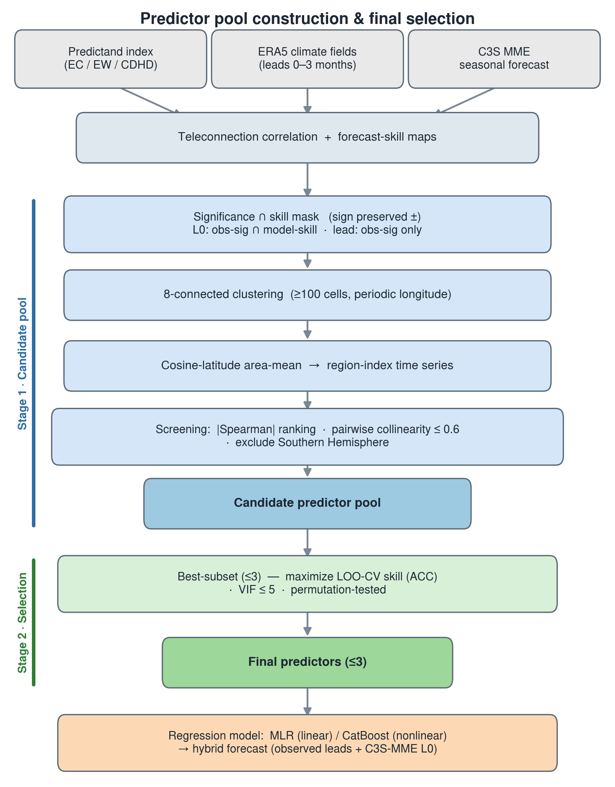

# SJU-Hybrid · Winter Extreme (Nonlinear / CatBoost)

Machine-learning (gradient-boosted decision trees, **CatBoost**) seasonal prediction of **Korean winter extreme-cold days (EC) and extreme-warm days (EW)** over the December–January–February (DJF) season.

This repository contains the **nonlinear (CatBoost) counterpart** of the statistical–dynamical model developed in the Korea Meteorological Administration (KMA) R&D project *“AI-based research on climate-extreme variability and prediction”* (Sejong University component). It uses the **same physically-screened predictor pool** as the linear model but replaces multiple linear regression with a **gradient-boosted tree estimator**, producing **tercile (below / near / above-normal) probabilistic forecasts**.

## Overview

- **Predictands:** DJF Korean extreme-cold-day count (**EC**) and extreme-warm-day count (**EW**), from an ERA5-based percentile index.
- **Predictors:** identical physically-motivated, skill-screened teleconnection pool as the linear model (see the sibling `…-linear` repository).
- **Estimator:** **CatBoost** (symmetric gradient-boosted trees). CatBoost is chosen for small-sample robustness (strong regularization via oblivious trees + ordered boosting) over XGBoost/LightGBM.
- **Output:** per-member hybrid forecast (observed lead predictors + C3S-MME L0), aggregated to tercile-category probabilities.

## How the predictors are built



Predictors are built in **two stages** — an automated, physically-constrained *candidate-pool construction* (identical across all four SJU-Hybrid models) followed by a *final selection* that keeps only the few predictors maximising out-of-sample skill.

**Stage 1 — candidate pool.** The detrended predictand index is correlated against global ERA5 climate fields (T2m, MSL, SST, Z500, U200, V200, T850, Z850, precipitation, …) at lead times of 0–3 months, and the C3S multi-model-ensemble (MME) forecast skill is mapped for each field in parallel. A grid cell becomes a predictor source only where it is physically *and* operationally useful, through a **dual-condition significance mask**:

- **concurrent (L0)** fields must be **both** significantly correlated with the predictand (Spearman, *p* < 0.05) **and** skilfully forecast by the dynamical ensemble (skill significant, *r* > 0) — so the statistical link can actually be exploited at forecast time;
- **lead (L1–L3)** fields require only observational significance, since they are already observed when the forecast is issued.

The relationship sign (±) is preserved. The mask is segmented into coherent regions by **8-connected component labelling** (periodic in longitude), keeping only clusters of **≥ 100 grid cells**, and each region is reduced to one **cosine-latitude area-mean** index time series. Candidates are ranked by |Spearman| with the predictand, then filtered by a **greedy pairwise-collinearity rule** (drop any with |Spearman| > 0.6 against an already-accepted index) and a **Southern-Hemisphere exclusion** — yielding the *candidate predictor pool* (≈ 70–80 regions per predictand).

**Stage 2 — final selection.** From the pool, **all subsets of up to three predictors** are scored by **leave-one-out cross-validated skill (anomaly correlation, ACC)** with a closed-form LOOCV (PRESS); multicollinearity is bounded by **VIF ≤ 5**, and the selected model's skill is tested against chance by a **permutation test**. Keeping the predictor count small (≤ 3) avoids overfitting the short (~45-season) record. The final predictors feed the regression model (**MLR** in the linear repositories, **CatBoost** in the nonlinear ones) — concurrent (L0) terms supplied operationally by the distribution-calibrated C3S-MME forecast, lead terms by observations.

## Method (pipeline)

| step | script | description |
|---|---|---|
| 1 | `src/00_corr_leads.py` | Detrended correlation of the EC/EW index against global climate fields at leads 0–3 months (teleconnection diagnosis). |
| 2 | `src/01_make_predictor_index.py` | Predictor-pool construction: significance ∩ dynamical-skill mask → 8-connected clustering (≥100 cells) → area-mean index → collinearity screening + SH exclusion. *(Shared with the linear model.)* |
| 3 | `src/02_forecast_catboost.py` | Leave-one-out CatBoost regression on the pooled predictors; per-ensemble-member prediction (observed leads + C3S-MME L0), categorized into observed terciles → below/near/above-normal probabilities. |

## Selected predictors

Same predictor pool as the linear model; CatBoost is a nonlinear tree estimator, so there is no single regression coefficient. L0 = concurrent-winter field (supplied by the dynamical ensemble at forecast time); L1–L3 = observed autumn precursors (L1 = Nov, L2 = Oct, L3 = Sep).

**EC — extreme-cold days**

| predictor | lead | variable | region |
|---|---|---|---|
| α | L0 (DJF) | 2-m temperature | Siberia (≈50°N, 105°E) |
| β | L3 (Sep) | precipitation | central North Pacific (≈44°N, 174°W) |
| γ | L2 (Oct) | precipitation | western Russia / Ural (≈48°N, 60°E) |

**EW — extreme-warm days**

| predictor | lead | variable | region |
|---|---|---|---|
| α | L0 (DJF) | 2-m temperature | subtropical NW Pacific (≈28°N, 137°E) |
| β | L1 (Nov) | 850-hPa temperature | N. Australia / Maritime Continent (≈14°S, 135°E) |
| γ | L0 (DJF) | 850-hPa temperature | Gulf of Alaska / Bering (≈58°N, 150°W) |

## Repository structure

```
.
├── src/
│   ├── 00_corr_leads.py           # teleconnection correlation maps (predictand vs fields, leads 0–3)
│   ├── 01_make_predictor_index.py # predictor-pool construction (shared with the linear model)
│   └── 02_forecast_catboost.py    # CatBoost tercile probabilistic forecast (EC_day | EW_day)
├── data/                          # input data (not included — see data/README.md)
├── requirements.txt
└── README.md
```

## Data

Raw datasets are **not included** (size / licensing). Place inputs under `./data/` (or set the path at the top of each script). Required inputs include the ERA5-based EC/EW index, ERA5 monthly fields, the screened predictor pool (`predictor_accepted_era5.npz`), and the **per-member C3S forecast predictor table** for the ensemble forecast. See `data/README.md`.

## Usage

```bash
pip install -r requirements.txt
# place inputs under ./data  (see data/README.md)
python src/00_corr_leads.py
python src/01_make_predictor_index.py
python src/02_forecast_catboost.py EC_day   # EC_day | EW_day
```

## References

This work applies the **statistical–dynamical (dynamical–statistical) seasonal-forecasting framework** of:

- Choi, J. *et al.* (2024). Dynamical–statistical method for seasonal forecasting of wintertime PM10 concentration in South Korea using multi-model ensemble climate forecasts. *Environmental Research Letters*, **19**, 064073. https://doi.org/10.1088/1748-9326/ad5030
- Jeong, J.-H., Choi, J., Jeong, J.-Y., Woo, S.-H., Kim, S.-W., Lee, D., Lee, J.-B., & Yoon, J.-H. (2022). A novel statistical–dynamical method for a seasonal forecast of particulate matter in South Korea. *Science of the Total Environment*, **848**, 157699. https://doi.org/10.1016/j.scitotenv.2022.157699

For explainable-AI (SHAP) analysis of Korean extremes, see also Kim *et al.* (2024), *npj Climate and Atmospheric Science* — https://doi.org/10.1038/s41612-024-00722-1.

## Authors

Jee-Hoon Jeong (정지훈)¹, Gyu-Ri Lee (이규리)¹
¹ Sejong University, Republic of Korea

## Funding

This research was supported by the **Korea Meteorological Administration Research and Development Program** under Grant **RS-2025-02307979**.

## Citation

If you use this code, please cite the associated project report / manuscript (Jeong, Lee et al., 2026) and acknowledge the funding grant above.

## Legal Notice

This repository contains original research code developed for academic and scientific purposes.

Any use, reproduction, modification, distribution, or derivative work based on this code is strictly prohibited without prior written permission from the authors.

If this code is used in any form of academic, research, or commercial work, proper citation and explicit acknowledgment of all original authors and affiliated institutions is mandatory.

Unauthorized use or redistribution without permission may result in legal consequences.
